# 类图与对象关系设计

## 1. 核心领域模型类图

### 1.1 用户与权限类图

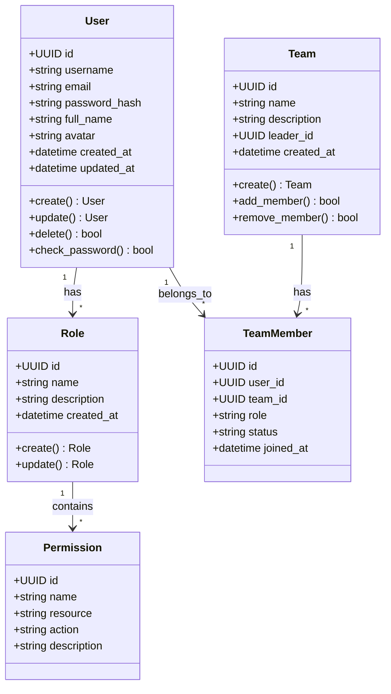

### 1.2 资产管理类图

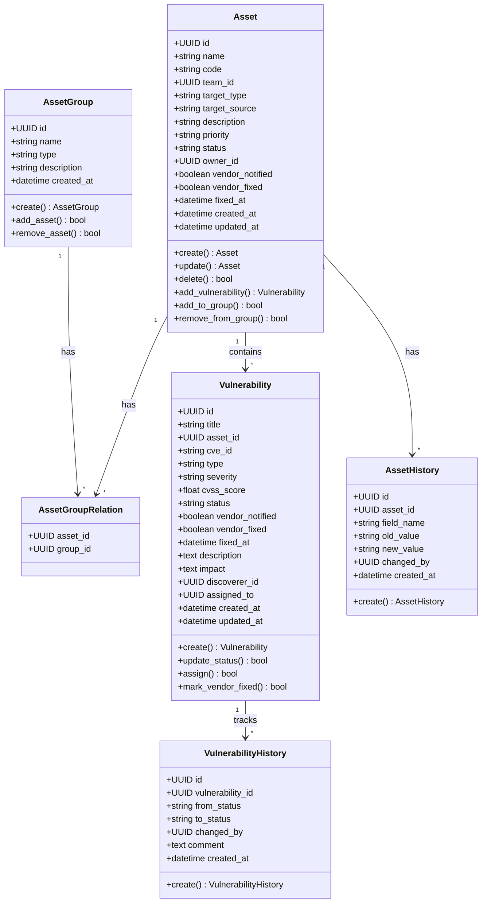

### 1.3 环境管理类图

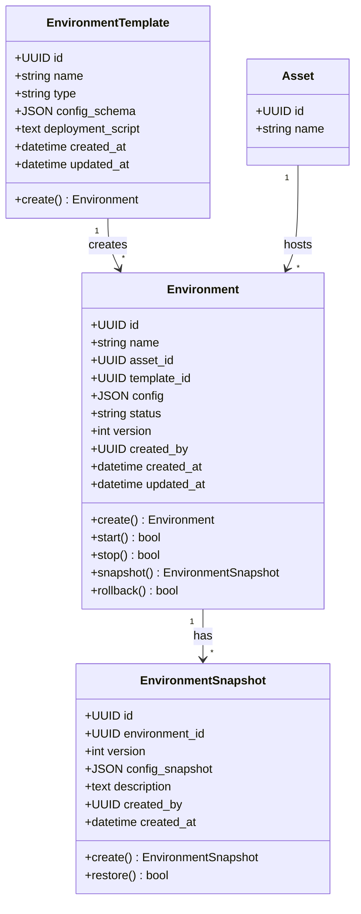

### 1.4 文档管理类图

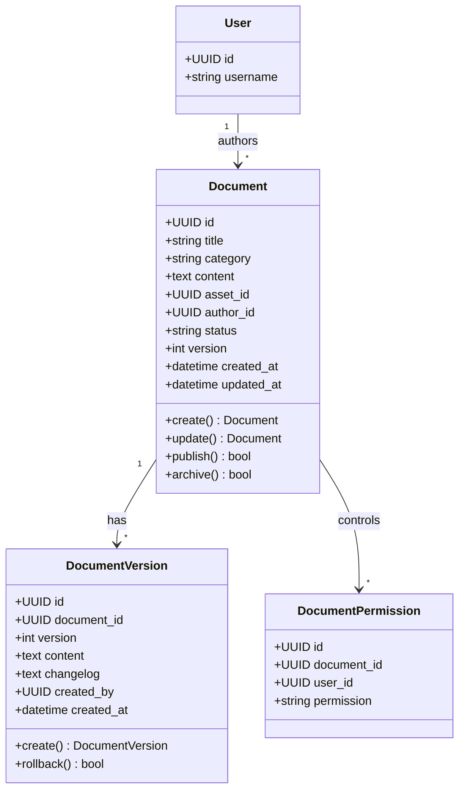

### 1.5 工具资源库类图

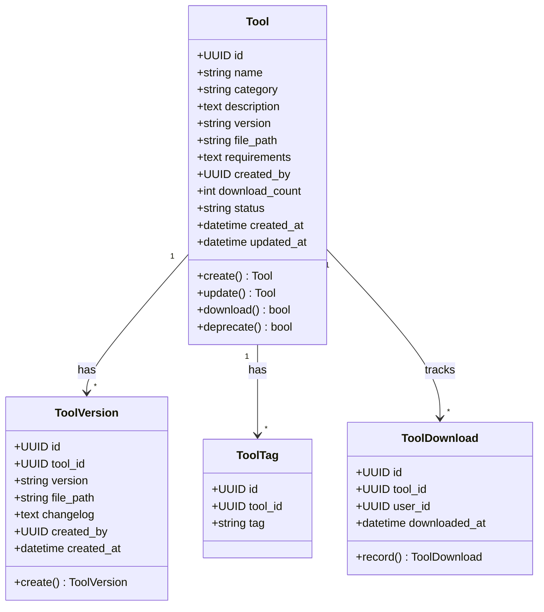

### 1.6 任务管理类图

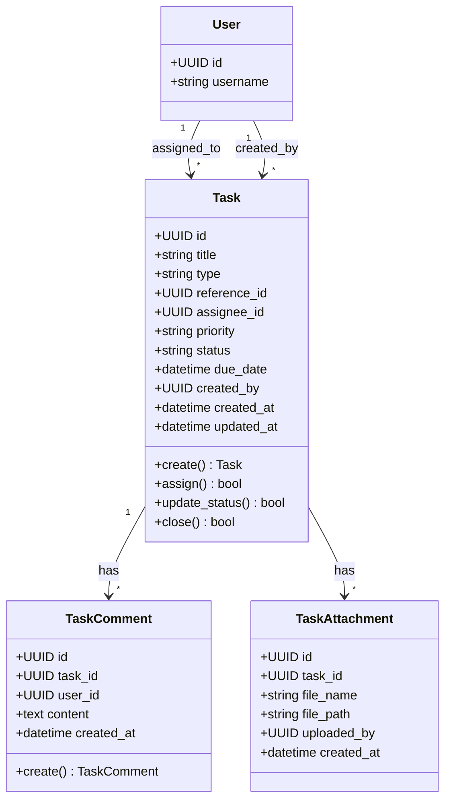

### 1.7 知识库类图

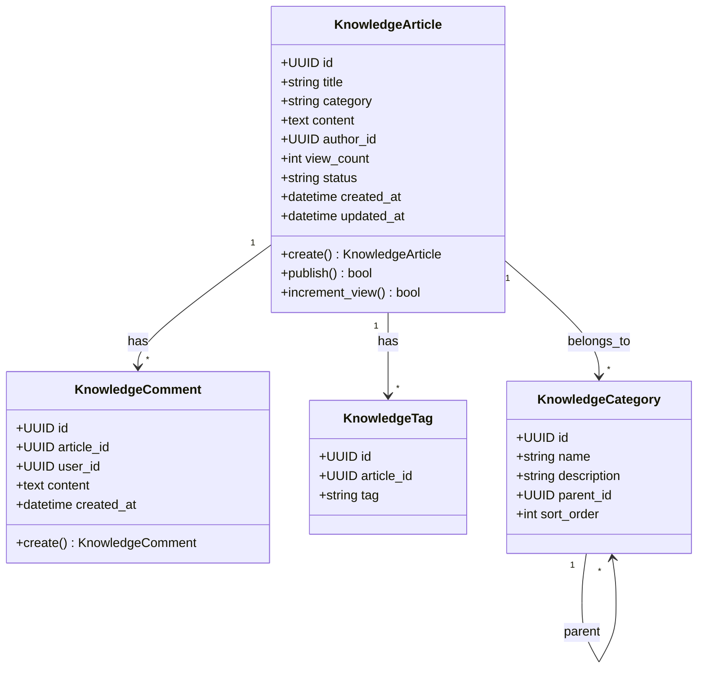

## 2. 服务层类图

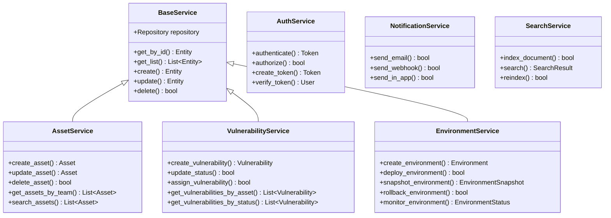

## 3. 控制器层类图

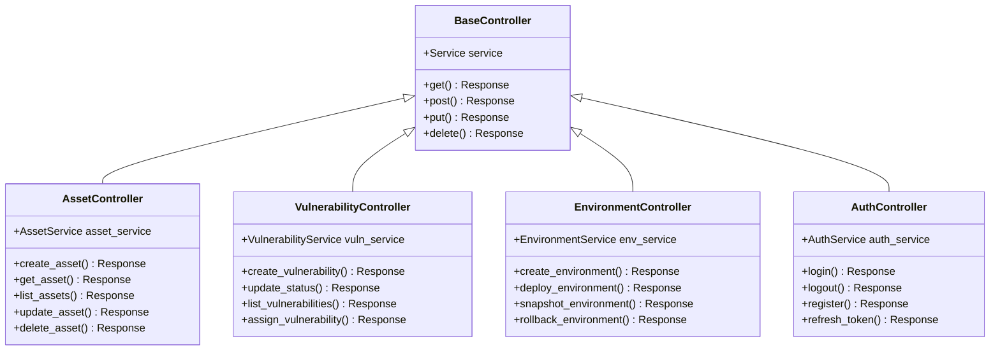

## 4. 仓储层类图

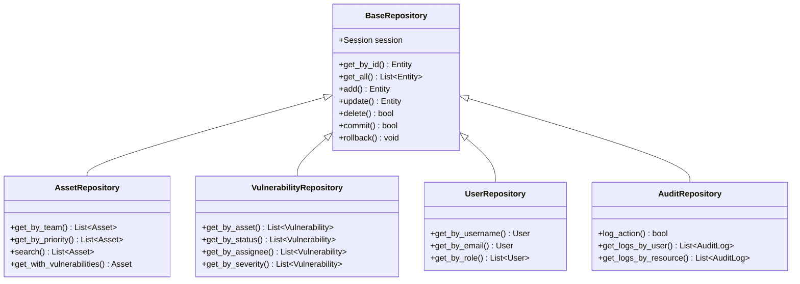

## 5. 领域事件类图

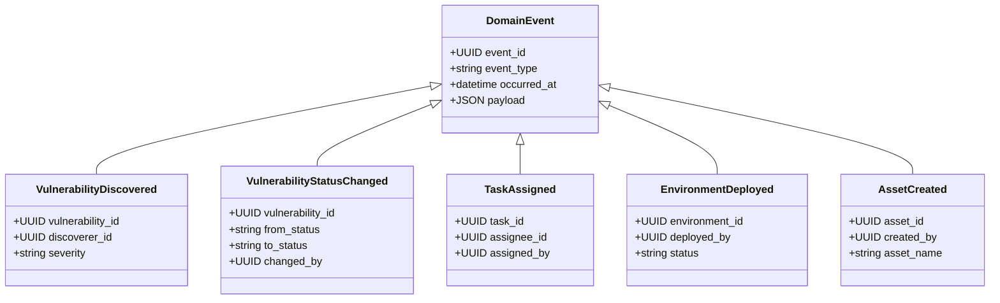
