# 数据库ER图设计

## 1. 核心实体关系图

> **设计原则**：
> - 多对多关系：通过中间表管理（如 asset_group_relations）
> - 一对多/多对一：通过外键管理
> - 关联详情见各实体字段定义

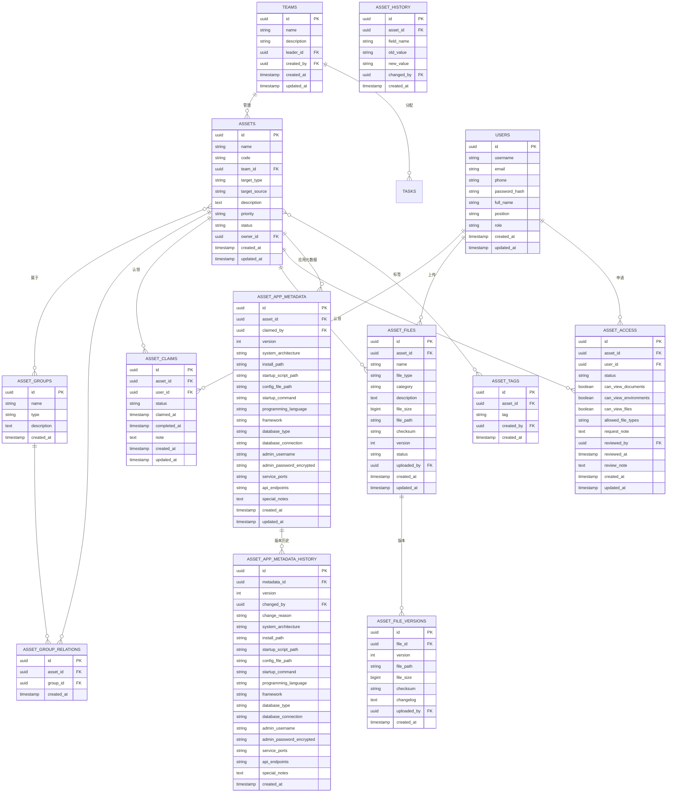

## 2. 漏洞管理实体关系

> **设计说明**：一对多关系通过外键管理

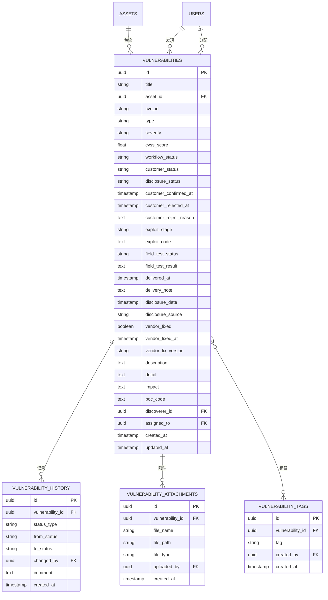

## 3. 环境管理实体关系

> **说明**：本模块为靶场环境管理功能，相关表结构暂保持为空实现，待后续需求明确后再行开发。
> **设计说明**：一对多关系通过外键管理

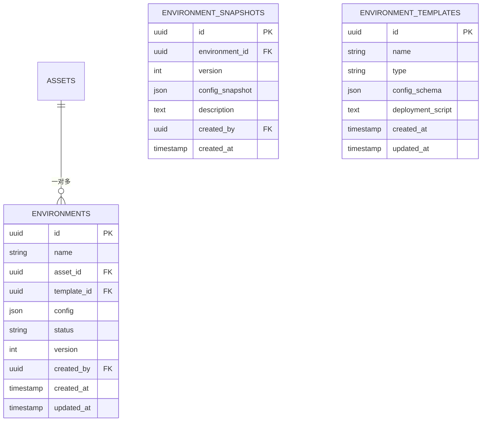

## 4. 文档管理实体关系

> **设计说明**：一对多关系通过外键管理

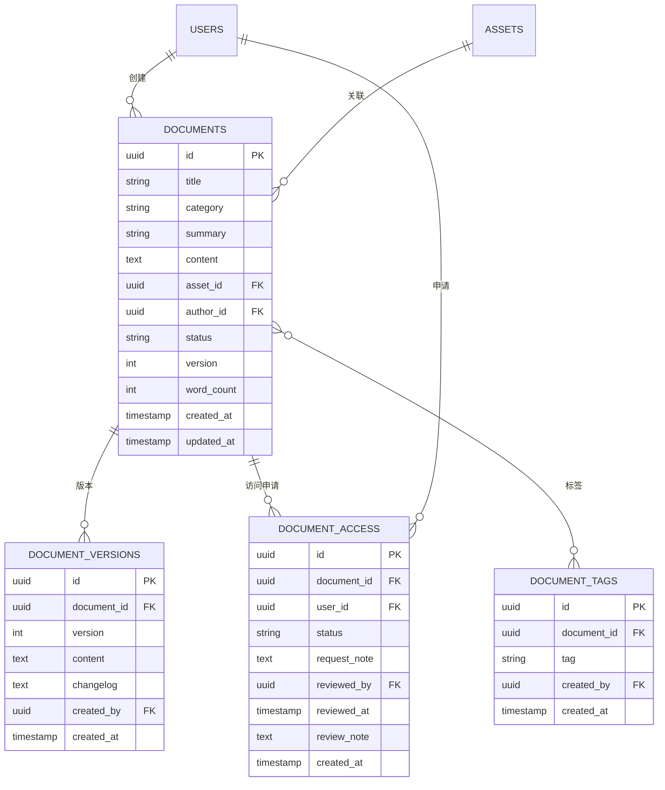

## 5. 工具资源库实体关系

> **设计说明**：一对多关系通过外键管理

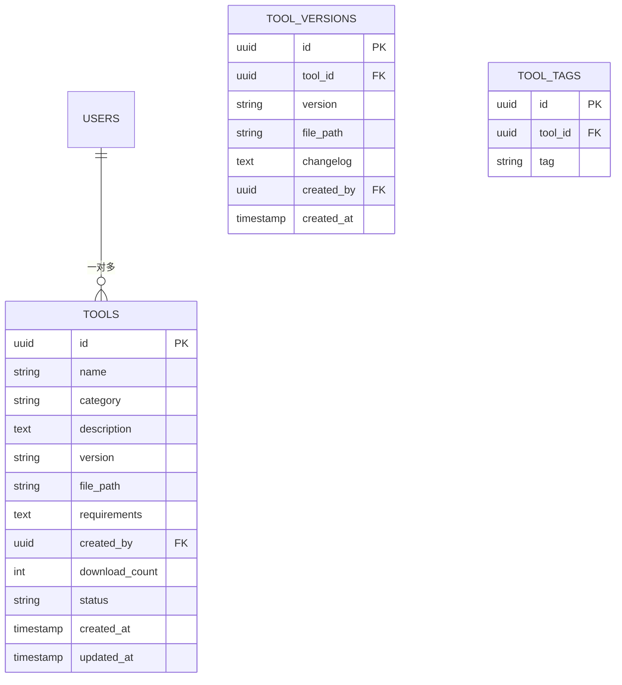

## 6. 任务管理实体关系

> **设计说明**：一对多关系通过外键管理

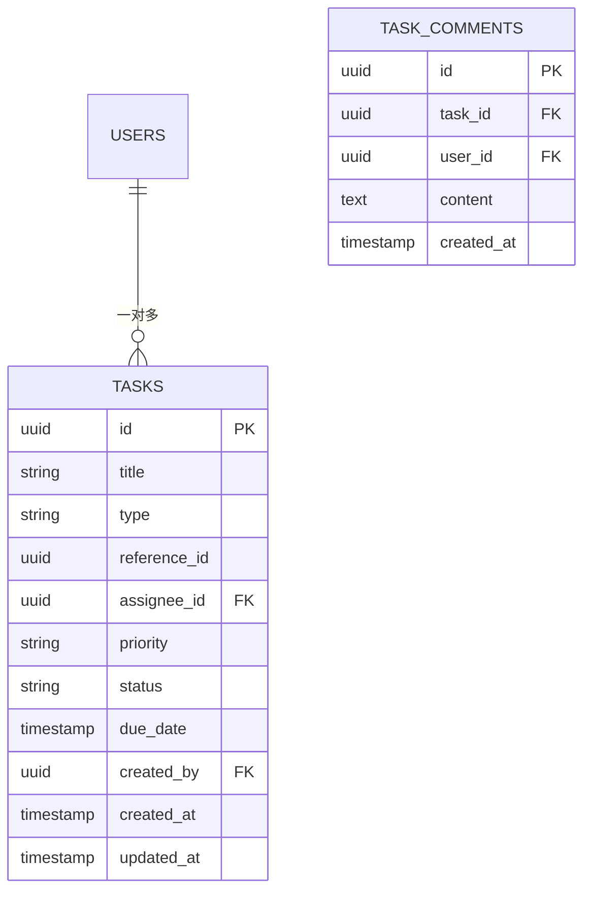

## 7. 知识库实体关系

> **设计说明**：一对多关系通过外键管理

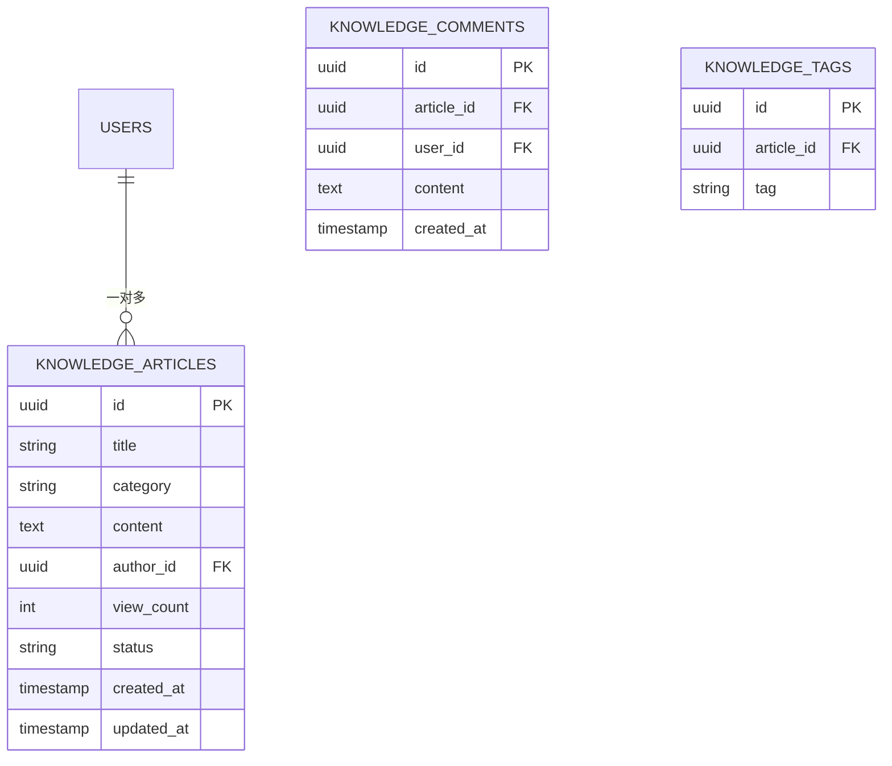

## 8. 权限控制实体关系

> **设计说明**：多对多关系通过中间表管理，一对多通过外键管理

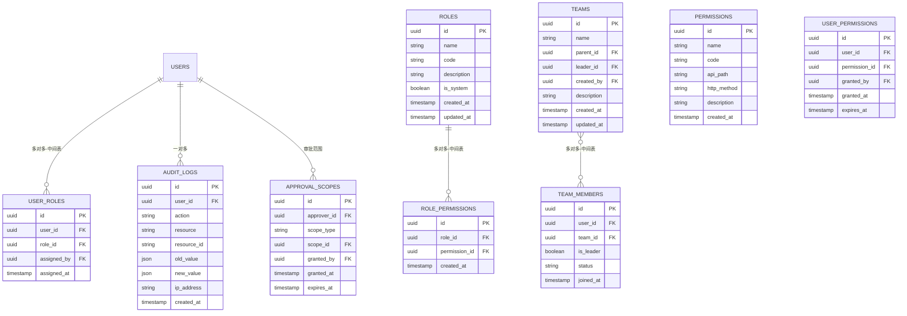

## 9. 消息通知实体关系

> **设计说明**：多对多关系通过中间表管理，一对多通过外键管理

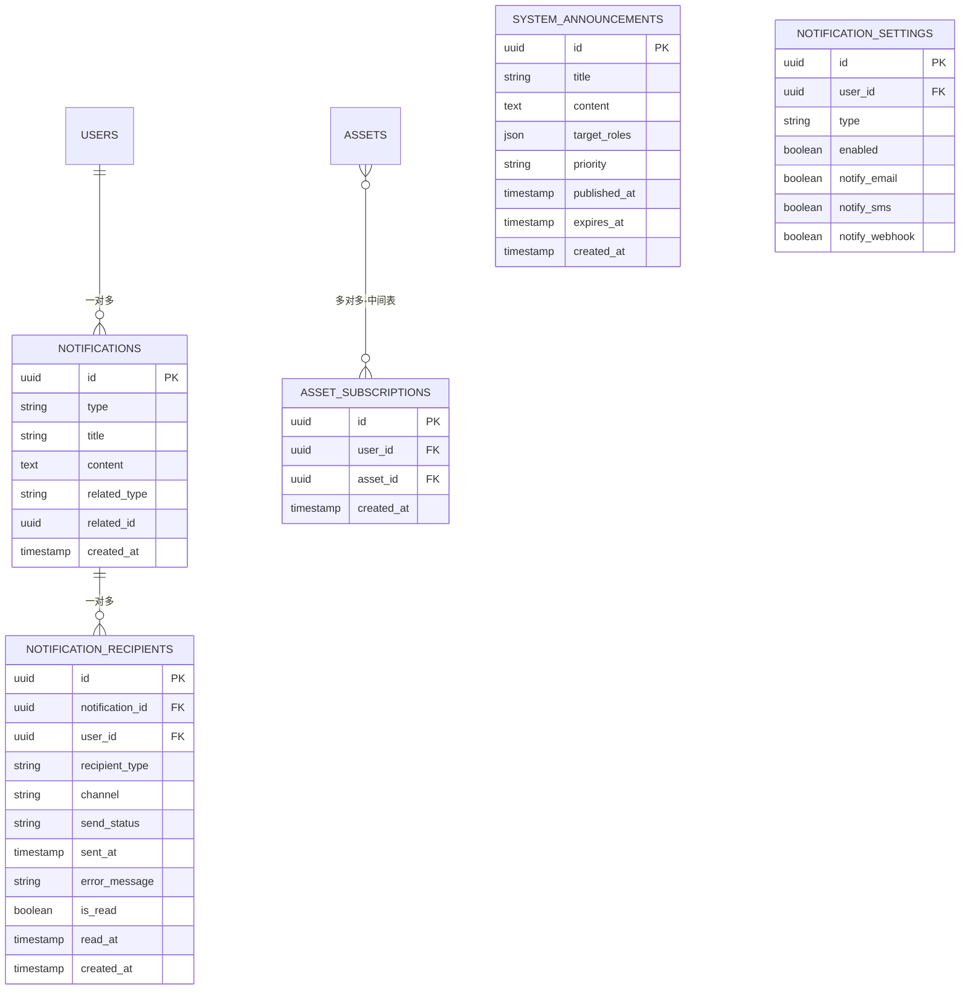

## 10. 仪表盘与统计实体关系

> **设计说明**：多对多关系通过中间表管理，一对多通过外键管理

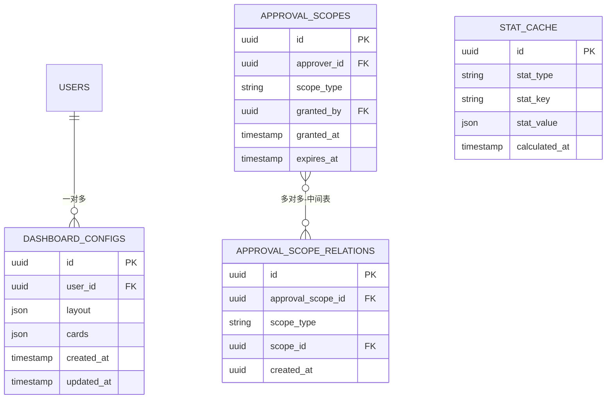

## 11. 第三方登录实体关系（预留）

> **设计说明**：一对多关系通过外键管理

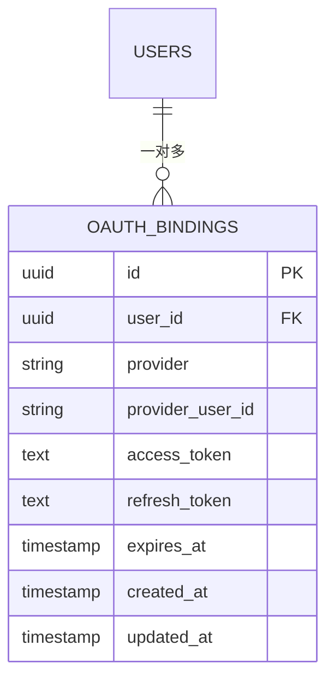

## 12. 完整ER图概览

```mermaid
erDiagram
    USERS ||--o{ TEAM_MEMBERS : ""
    USERS ||--o{ ASSETS : ""
    USERS ||--o{ VULNERABILITIES : ""
    USERS ||--o{ ENVIRONMENTS : ""
    USERS ||--o{ DOCUMENTS : ""
    USERS ||--o{ TOOLS : ""
    USERS ||--o{ TASKS : ""
    USERS ||--o{ KNOWLEDGE_ARTICLES : ""
    USERS ||--o{ AUDIT_LOGS : ""
    USERS ||--o{ ASSET_CLAIMS : ""
    USERS ||--o{ ASSET_FILES : ""
    
    TEAMS ||--o{ ASSETS : ""
    TEAMS ||--o{ TASKS : ""
    
    ASSETS ||--o{ VULNERABILITIES : ""
    ASSETS ||--o{ ENVIRONMENTS : ""
    ASSETS ||--o{ DOCUMENTS : ""
    ASSETS ||--o{ ASSET_CLAIMS : ""
    ASSETS ||--o{ ASSET_ACCESS : ""
    ASSETS ||--o{ ASSET_FILES : ""
    ASSETS ||--o{ ASSET_APP_METADATA : ""
    ASSET_APP_METADATA ||--o{ ASSET_APP_METADATA_HISTORY : ""
    ASSET_FILES ||--o{ ASSET_FILE_VERSIONS : ""
    USERS ||--o{ ASSET_ACCESS : ""
    
    ENVIRONMENT_TEMPLATES ||--o{ ENVIRONMENTS : ""
    
    VULNERABILITIES ||--o{ VULNERABILITY_HISTORY : ""
    
    DOCUMENTS ||--o{ DOCUMENT_VERSIONS : ""
    DOCUMENTS ||--o{ DOCUMENT_ACCESS : ""
    USERS ||--o{ DOCUMENT_ACCESS : ""
    
    TOOLS ||--o{ TOOL_VERSIONS : ""
    
    TASKS ||--o{ TASK_COMMENTS : ""
    
    KNOWLEDGE_ARTICLES ||--o{ KNOWLEDGE_COMMENTS : ""
    
    ROLES ||--o{ USER_ROLES : ""
    ROLES ||--o{ ROLE_PERMISSIONS : ""
    PERMISSIONS ||--o{ ROLE_PERMISSIONS : ""
```
