# 时序图设计

## 1. 用户认证流程

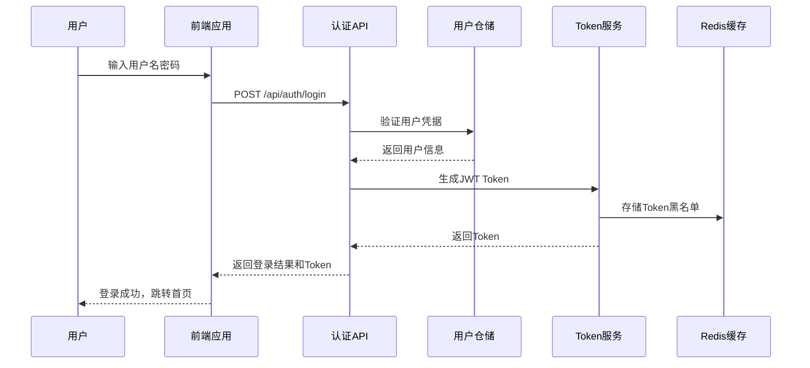

## 2. 漏洞提交流程

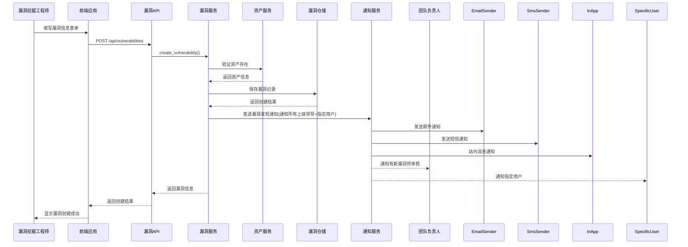

## 3. 漏洞状态变更流程

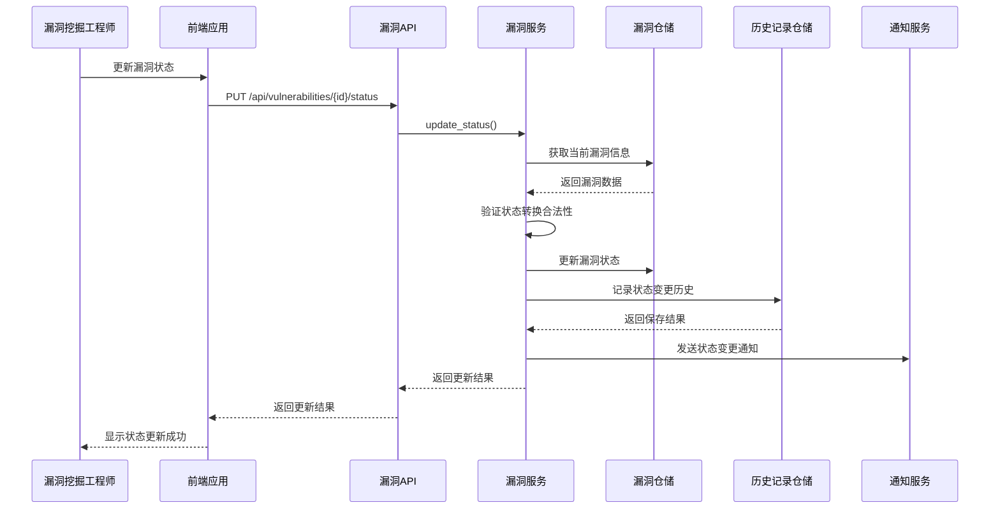

## 4. 环境创建与部署流程

> **说明**：本模块为靶场环境管理功能，相关流程暂保持为空实现，待后续需求明确后再行开发。

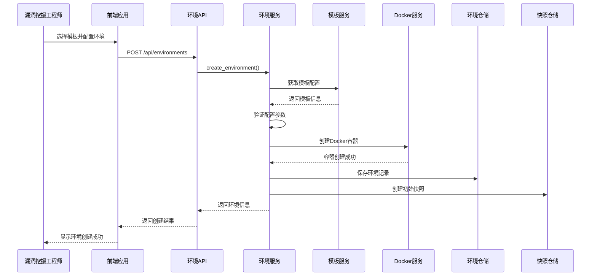

## 5. 环境快照与回滚流程

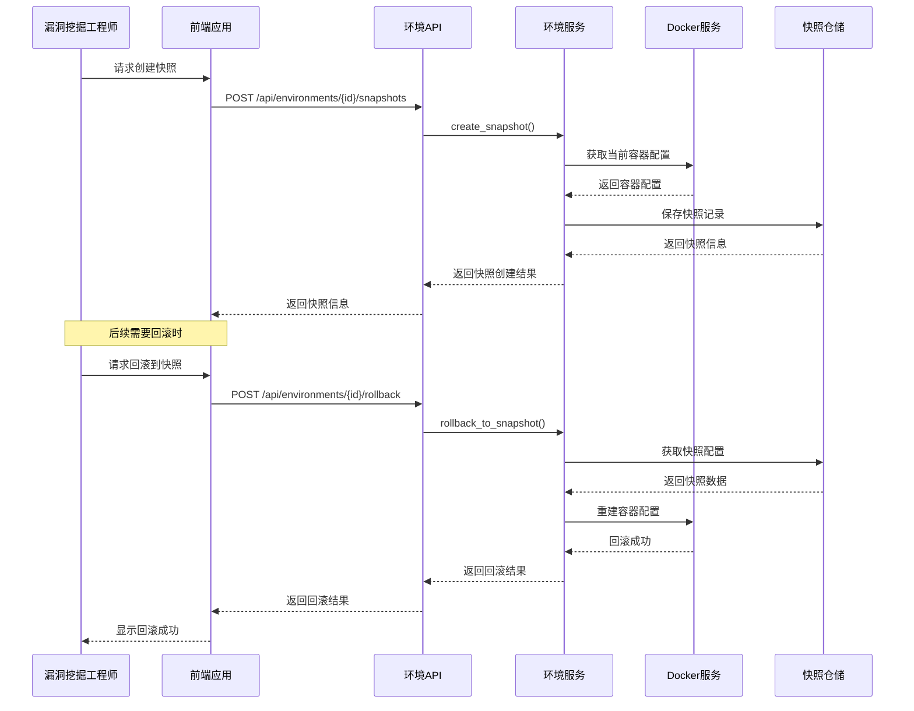

## 6. 文档创建与版本管理流程

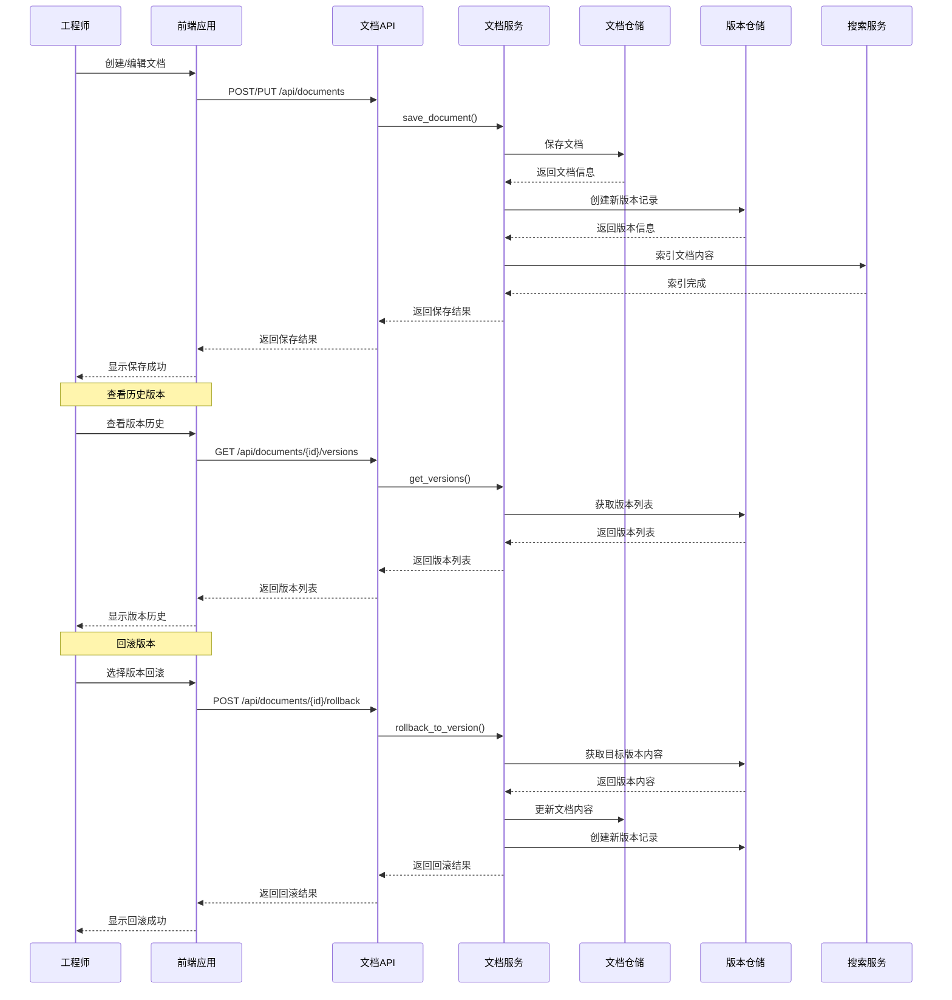

## 7. 任务分配流程

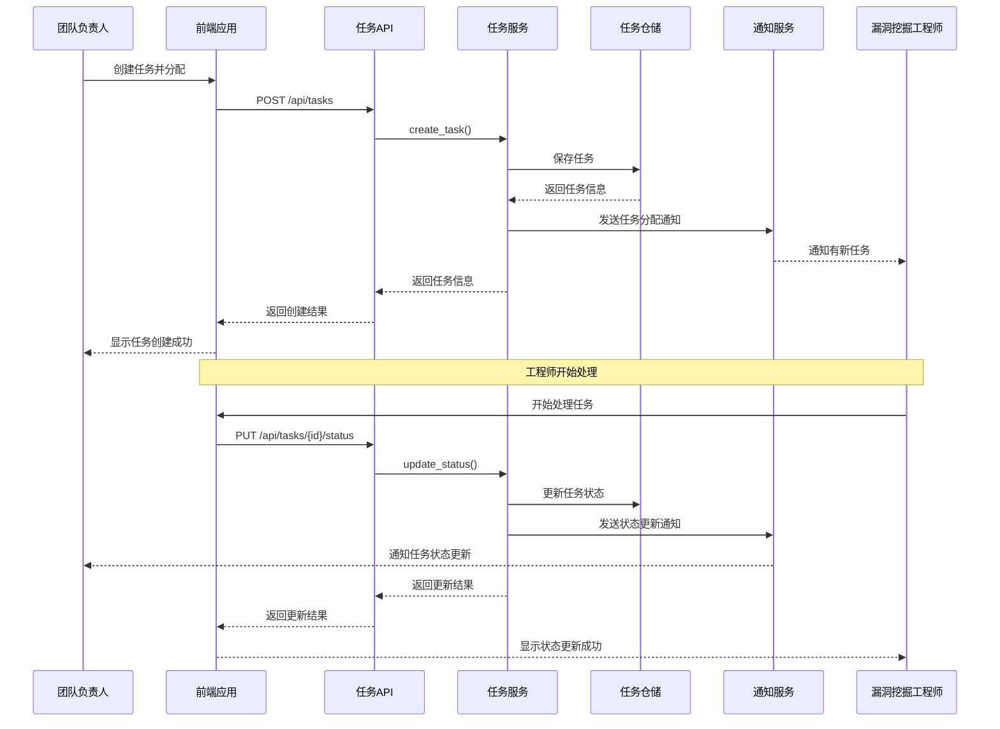

## 8. 工具上传与下载流程

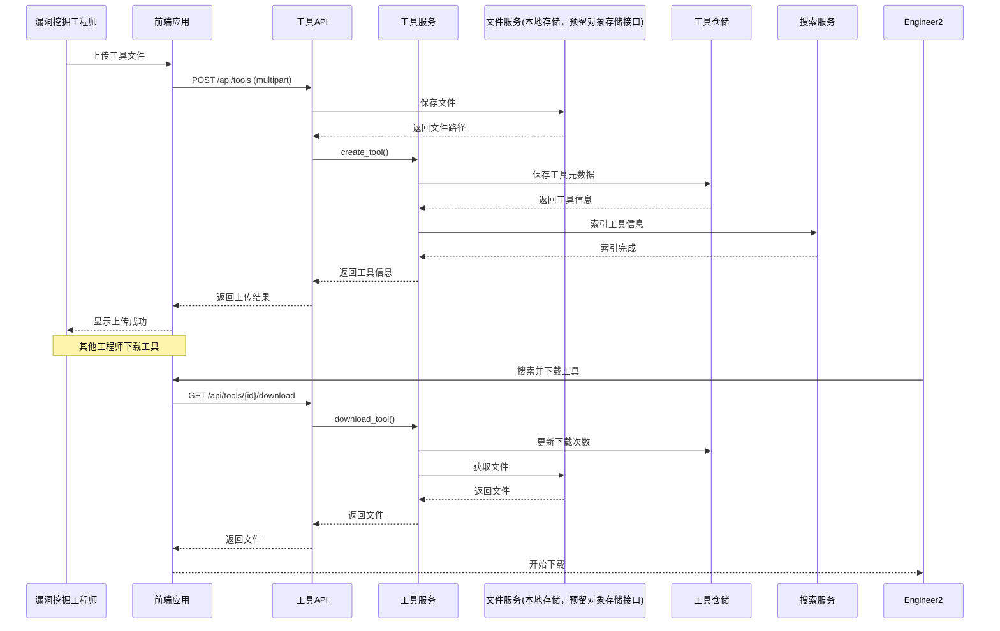

## 9. 权限验证流程

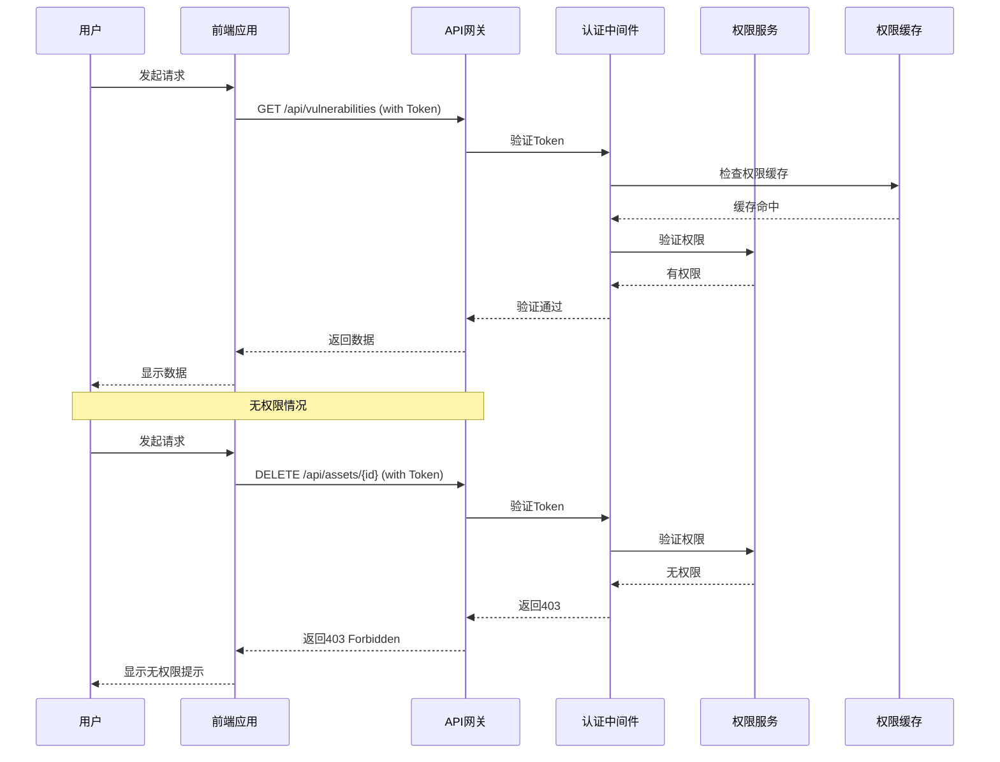

## 10. 资产认领流程

> **说明**：资产认领为自动批准，无需人工审核

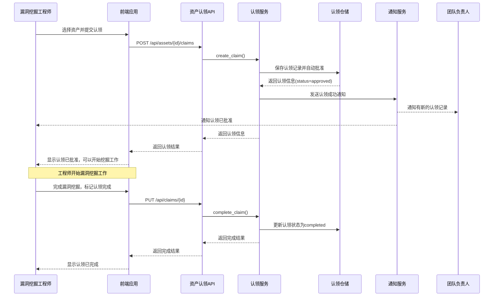

## 11. 数据备份流程

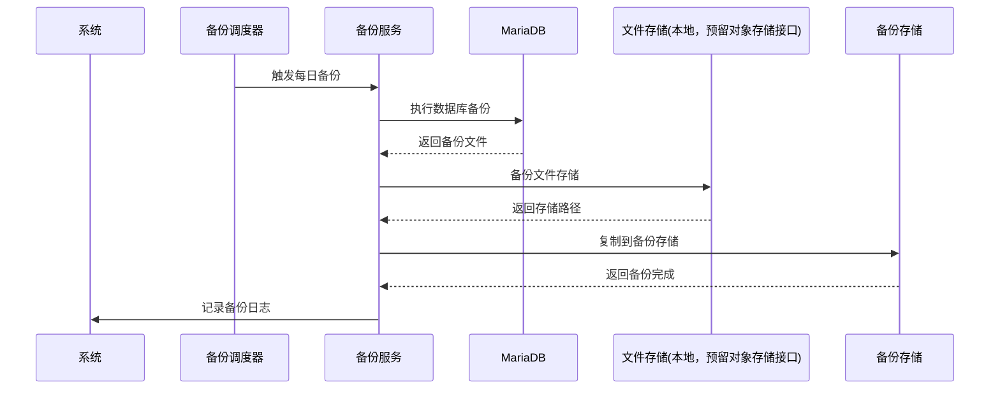

## 12. 资产访问申请与审批流程

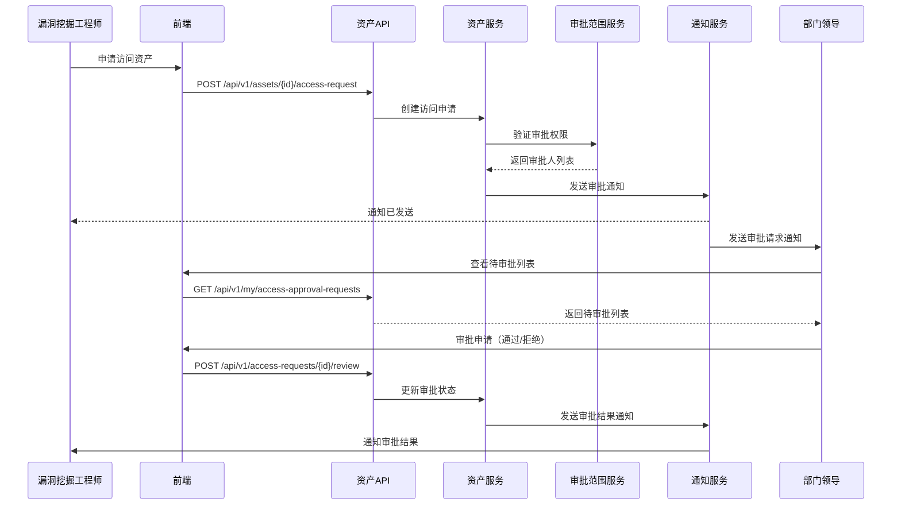

## 13. 消息通知流程

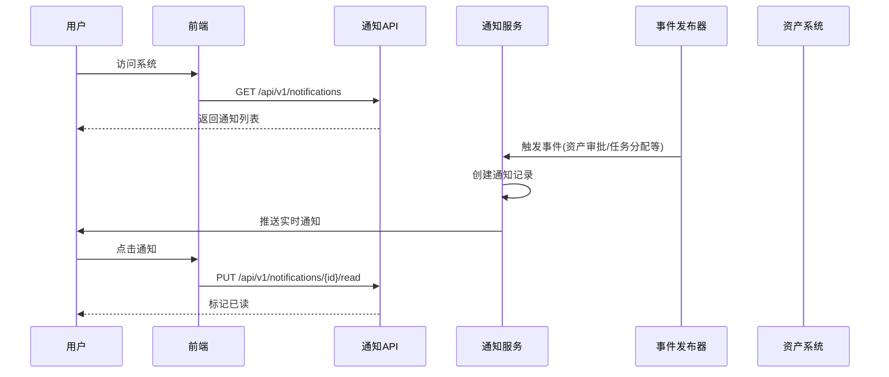

## 14. 仪表盘数据统计流程

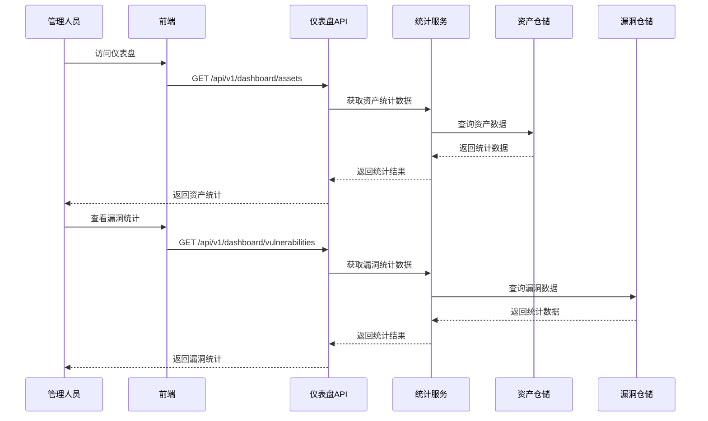
