# 状态图设计

## 1. 漏洞生命周期状态图

### 1.1 工作流状态 (workflow_status)

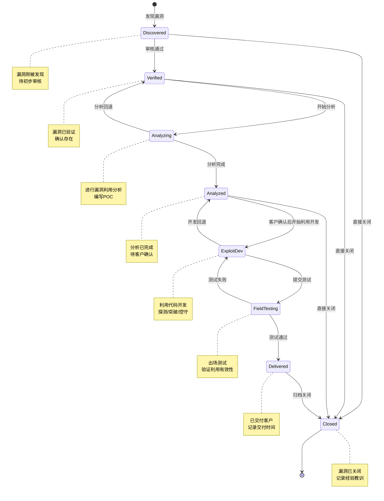

### 1.2 客户确认状态 (customer_status)

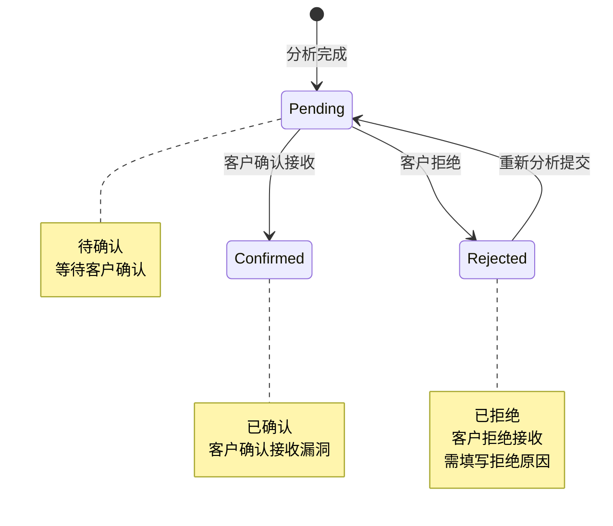

### 1.3 公开披露状态 (disclosure_status)

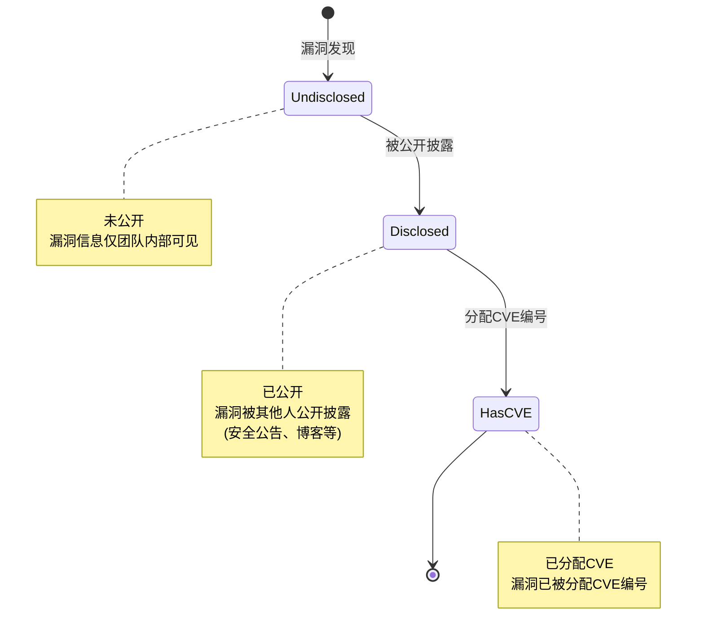

### 1.4 厂商修复追踪

> **说明**：厂商修复状态通过公开渠道观察，不主动通知厂商。

| 字段 | 说明 |
|------|------|
| vendor_fixed | 厂商是否已修复（通过公开渠道观察） |
| vendor_fixed_at | 厂商修复时间 |
| vendor_fix_version | 修复版本号 |

### 1.5 状态关联规则

| workflow_status | customer_status | disclosure_status | 说明 |
|-----------------|-----------------|-------------------|------|
| analyzed | pending | undisclosed | 分析完成，等待客户确认 |
| exploit_development | confirmed | any | 客户确认后，进入利用开发 |
| analyzing | rejected | any | 客户拒绝后，回退到分析中 |
| any | any | disclosed | 漏洞被公开披露，不影响工作流 |

> **注意**：
> - disclosure_status 独立于 workflow_status，可在任意阶段更新
> - 厂商修复状态（vendor_fixed）通过公开渠道观察，不主动通知厂商
> - 通过CVE数据库、安全公告、社交媒体等渠道观察漏洞是否被披露

## 2. 资产状态图

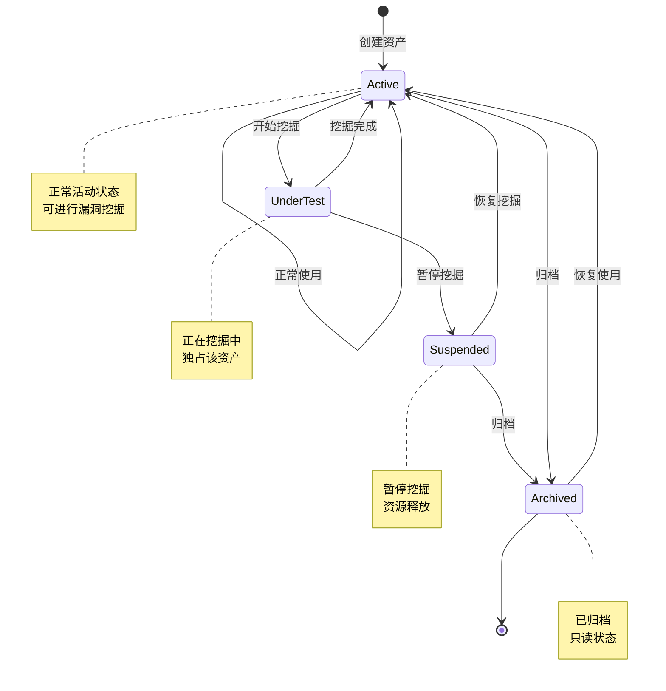

## 3. 环境状态图

> **说明**：本模块为靶场环境管理功能，相关状态暂保持为空实现，待后续需求明确后再行开发。

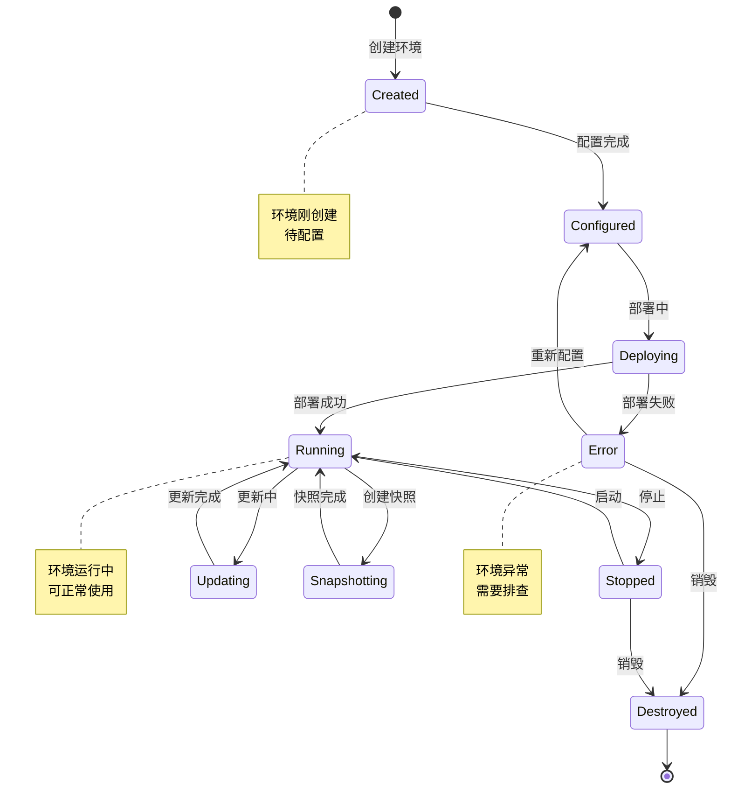

## 4. 任务状态图

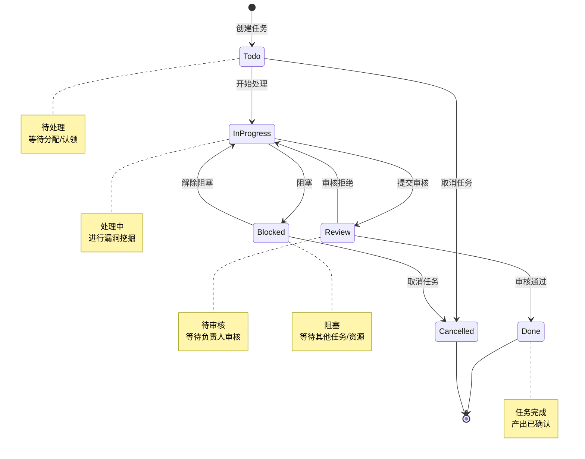

## 5. 文档状态图

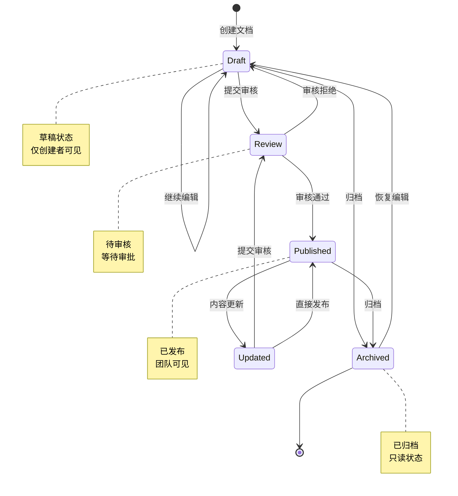

## 6. 工具状态图

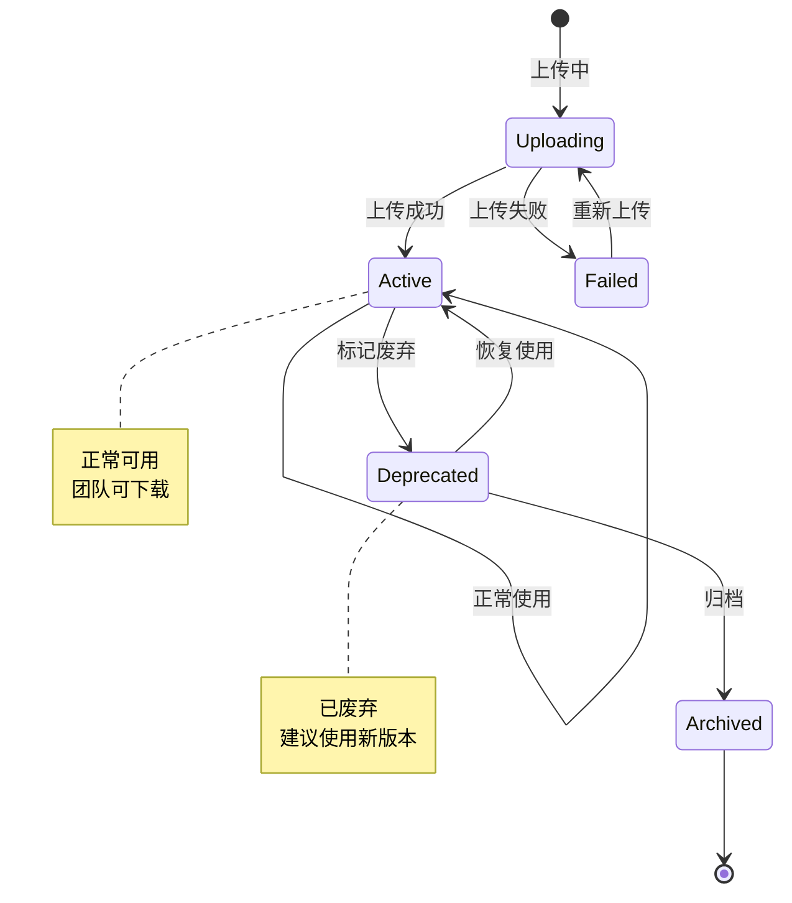

## 7. 用户状态图

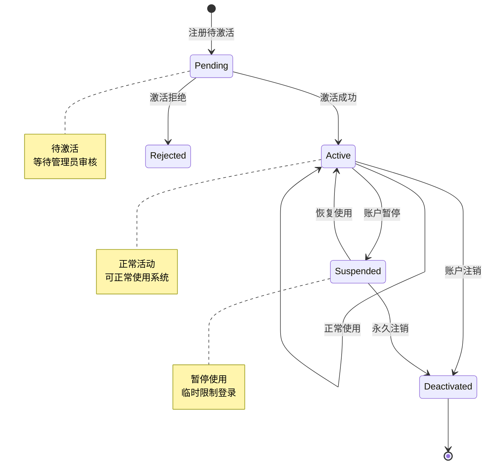

## 8. 团队成员状态图

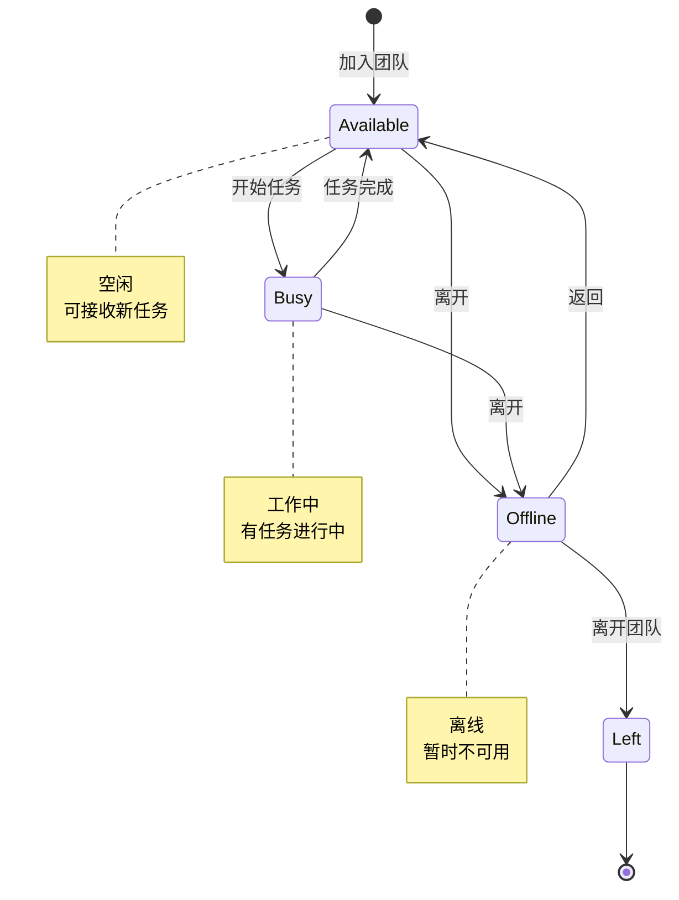

## 9. 资产认领状态图

> **说明**：资产认领为自动批准，无需人工审核

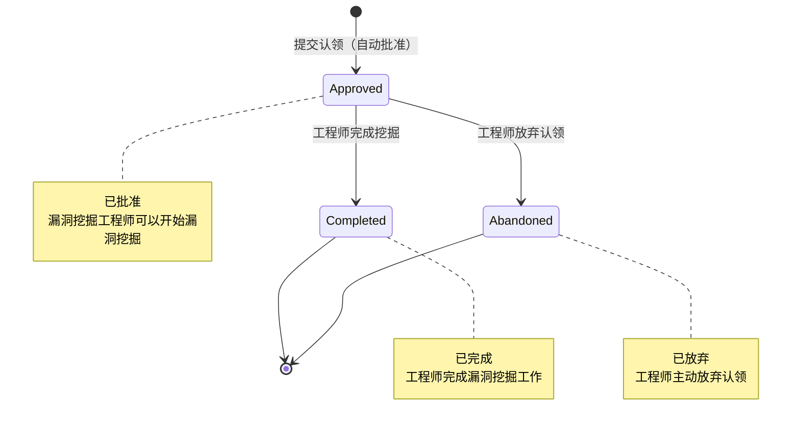

## 10. 漏洞优先级与状态关系

```mermaid
graph LR
    subgraph Critical["严重 P0"]
        C1[Discovered] --> C2[Verified]
        C2 --> C3[Analyzing]
        C3 --> C4[Analyzed]
        C4 --> C5[ExploitDev]
        C5 --> C6[FieldTesting]
        C6 --> C7[Delivered]
        C7 --> C8[Closed]
    end
    
    subgraph High["高 P1"]
        H1[Discovered] --> H2[Verified]
        H2 --> H3[Analyzing]
        H3 --> H4[Analyzed]
        H4 --> H5[ExploitDev]
        H5 --> H6[FieldTesting]
        H6 --> H7[Delivered]
        H7 --> H8[Closed]
    end
    
    subgraph Medium["中 P2"]
        M1[Discovered] --> M2[Verified]
        M2 --> M3[Analyzing]
        M3 --> M4[Analyzed]
        M4 --> M5[ExploitDev]
        M5 --> M6[FieldTesting]
        M6 --> M7[Delivered]
        M7 --> M8[Closed]
    end
    
    subgraph Low["低 P3"]
        L1[Discovered] --> L2[Verified]
        L2 --> L3[Analyzing]
        L3 --> L4[Analyzed]
        L4 --> L5[ExploitDev]
        L5 --> L6[FieldTesting]
        L6 --> L7[Delivered]
        L7 --> L8[Closed]
    end
    
    style Critical fill:#ff6666
    style High fill:#ffaa66
    style Medium fill:#ffdd66
    style Low fill:#66aaff
```

> **说明**：客户确认状态(customer_status)和公开披露状态(disclosure_status)独立于工作流状态，不影响优先级流转。

## 11. 状态转换规则表

### 11.1 漏洞工作流状态转换规则

| 当前状态 | 目标状态 | 触发条件 | 权限要求 | 备注 |
|----------|----------|----------|----------|------|
| Discovered | Verified | 审核通过 | 团队负责人 | 需要至少一名审核人 |
| Discovered | Closed | 直接关闭 | 团队负责人 | 无效漏洞 |
| Verified | Analyzing | 开始分析 | 漏洞挖掘工程师 | 自动通知分配人 |
| Verified | Closed | 直接关闭 | 团队负责人 | 取消挖掘 |
| Analyzing | Analyzed | 分析完成 | 漏洞挖掘工程师 | 需要提交分析报告 |
| Analyzing | Verified | 分析回退 | 漏洞挖掘工程师 | 需要重新验证 |
| Analyzed | ExploitDev | 客户确认后开始利用开发 | 漏洞挖掘工程师 | 需要客户确认 |
| Analyzed | Closed | 直接关闭 | 团队负责人 | 取消挖掘 |
| ExploitDev | FieldTesting | 提交出场测试 | 漏洞挖掘工程师 | 利用代码完成 |
| ExploitDev | Analyzed | 开发回退 | 漏洞挖掘工程师 | 需要重新分析 |
| FieldTesting | Delivered | 测试通过 | 漏洞挖掘工程师 | 可以交付 |
| FieldTesting | ExploitDev | 测试失败 | 漏洞挖掘工程师 | 需要修复利用代码 |
| Delivered | Closed | 归档关闭 | 团队负责人 | 完成归档 |

### 11.2 客户确认状态转换规则

| 当前状态 | 目标状态 | 触发条件 | 权限要求 | 备注 |
|----------|----------|----------|----------|------|
| Pending | Confirmed | 客户确认接收 | 客户 | 确认接收漏洞 |
| Pending | Rejected | 客户拒绝 | 客户 | 需填写拒绝原因 |
| Rejected | Pending | 重新分析提交 | 漏洞挖掘工程师 | 修改后重新提交 |

### 11.3 公开披露状态转换规则

| 当前状态 | 目标状态 | 触发条件 | 权限要求 | 备注 |
|----------|----------|----------|----------|------|
| Undisclosed | Disclosed | 漏洞被公开披露 | 系统自动/手动更新 | 通过公开渠道观察 |
| Disclosed | HasCVE | 分配CVE编号 | 系统自动/手动更新 | CVE数据库同步 |

### 11.4 其他状态转换规则

| 当前状态 | 目标状态 | 触发条件 | 权限要求 | 备注 |
|----------|----------|----------|----------|------|
| Todo | InProgress | 开始处理 | 任务接收人 | 更新团队状态 |
| InProgress | Review | 提交审核 | 任务处理人 | 产出需可验证 |
| Review | Done | 审核通过 | 团队负责人 | 自动通知 |
| Draft | Review | 提交审核 | 文档作者 | 需指定审核人 |
| Review | Published | 审核通过 | 审核人 | 自动索引 |
| Approved | Completed | 挖掘完成 | 漏洞挖掘工程师 | 完成漏洞挖掘 |
| Approved | Abandoned | 放弃认领 | 漏洞挖掘工程师 | 主动放弃 |

## 12. 资产访问审批状态图

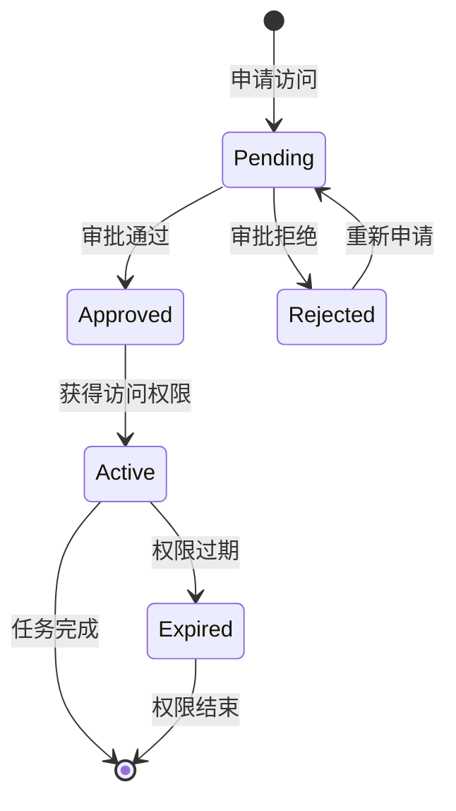

| 当前状态 | 目标状态 | 触发条件 | 权限要求 | 备注 |
|----------|----------|----------|----------|------|
| Pending | Approved | 审批通过 | 部门领导 | 在审批范围内 |
| Pending | Rejected | 审批拒绝 | 部门领导 | 在审批范围内 |
| Approved | Active | 权限生效 | 系统 | 自动激活 |
| Active | Expired | 权限过期 | 系统 | 超过授权时间 |
| Rejected | Pending | 重新申请 | 申请者 | 修改申请内容 |
| Expired | Pending | 重新申请 | 申请者 | 需要重新审批 |
