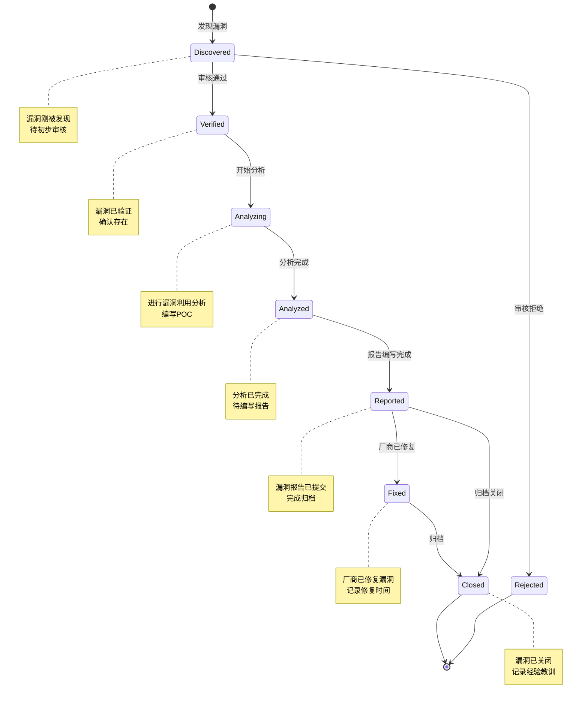
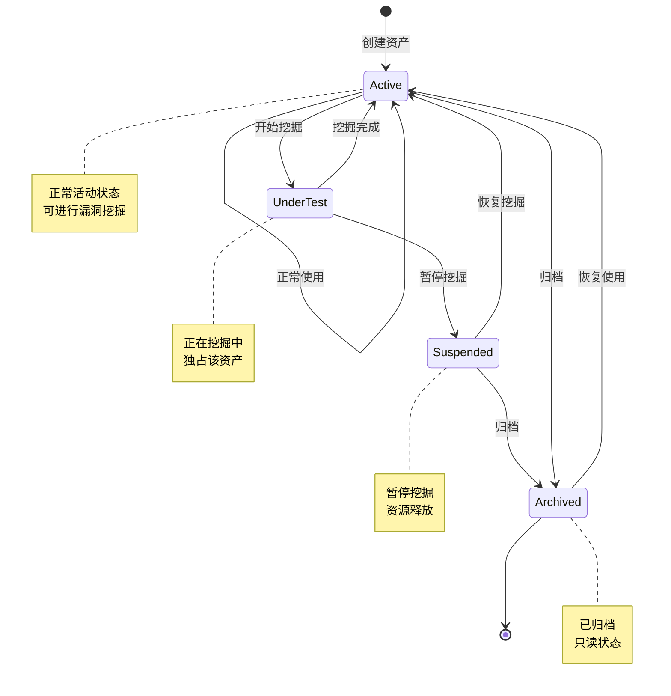
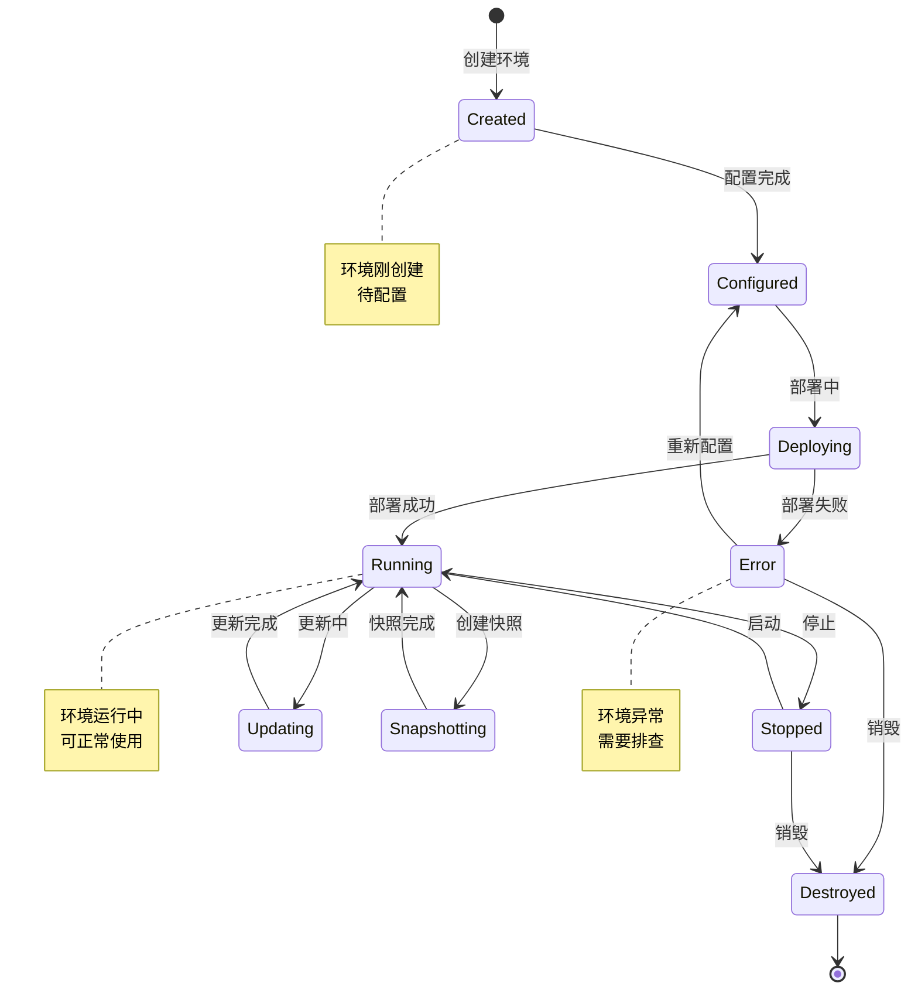
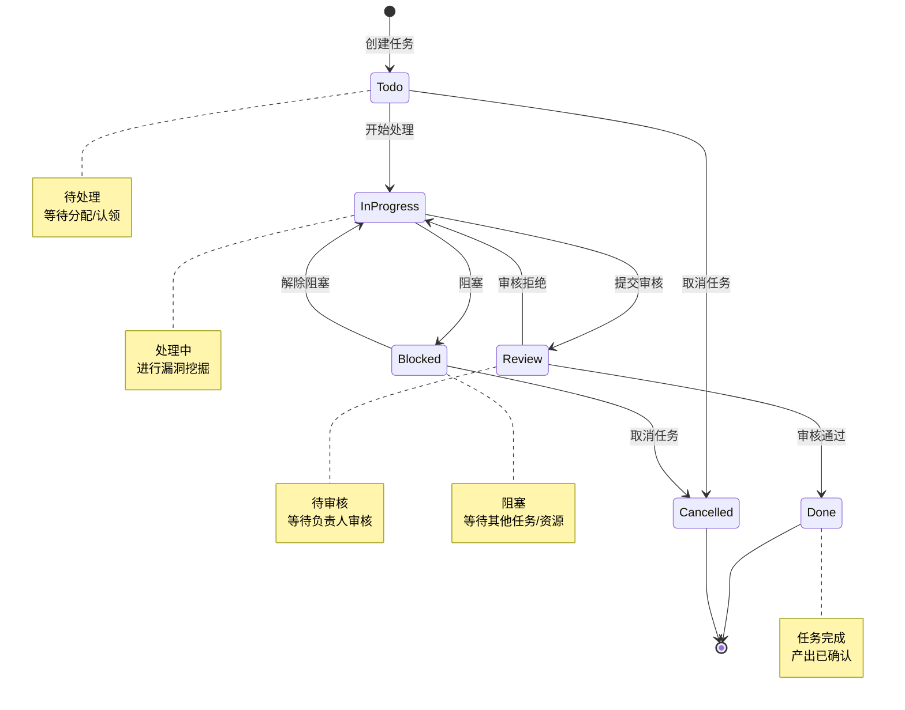
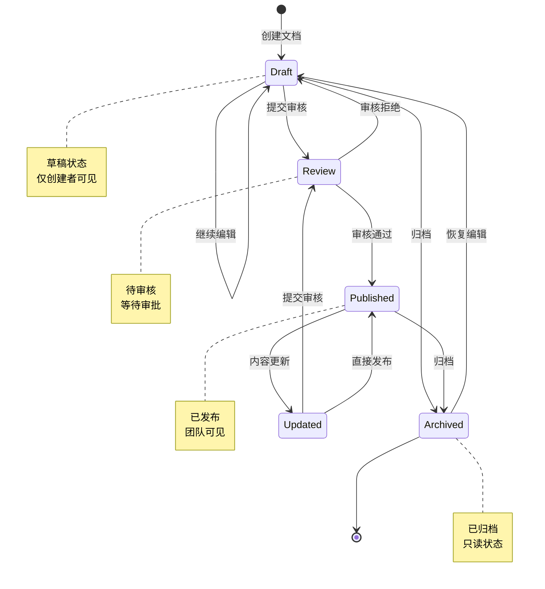
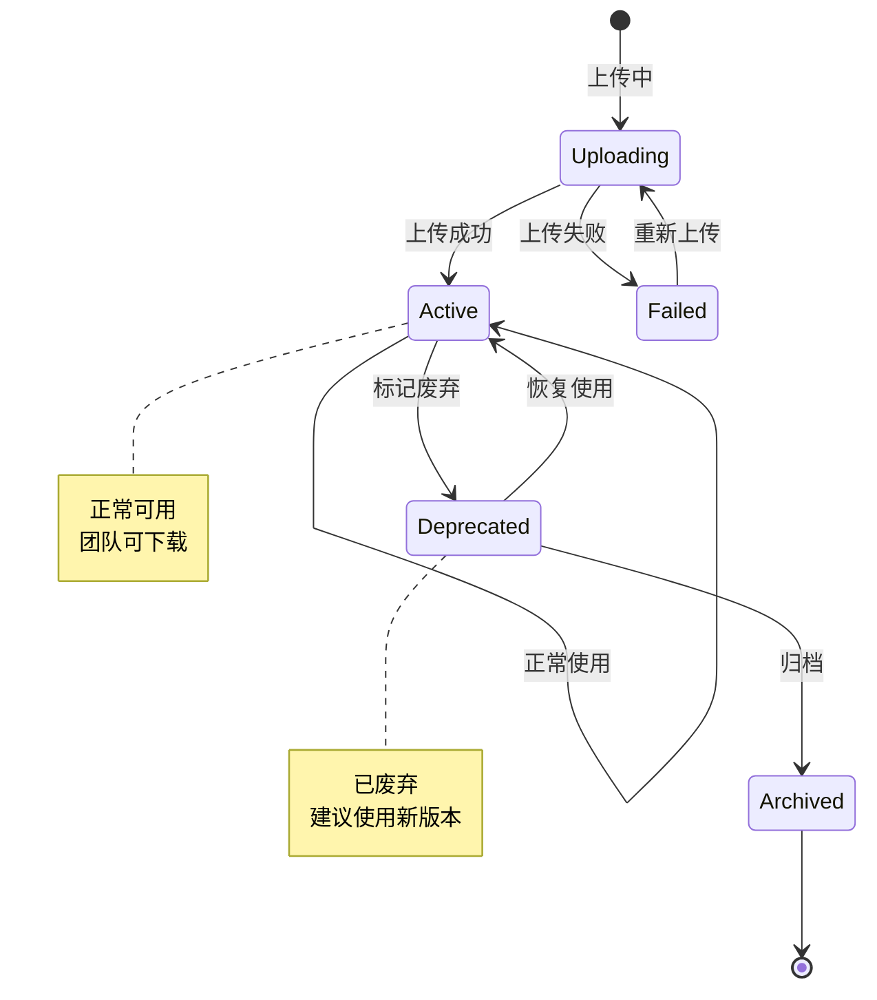
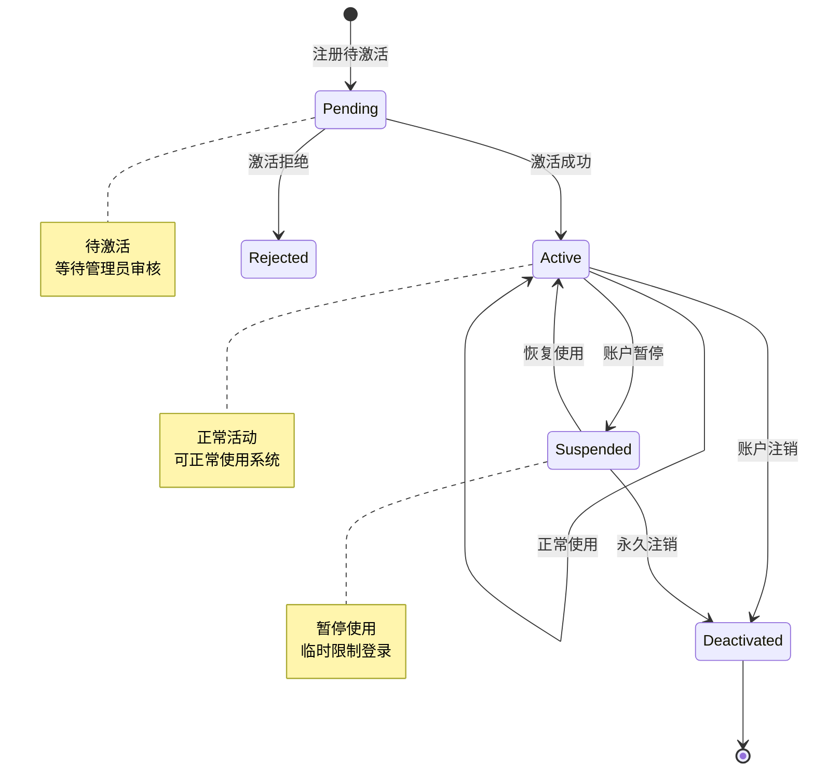
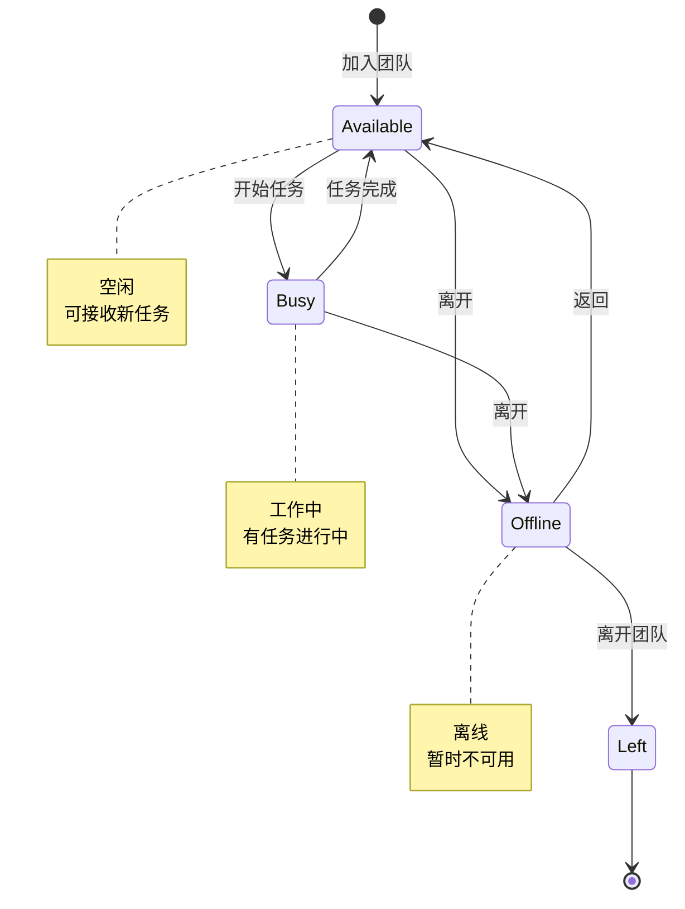
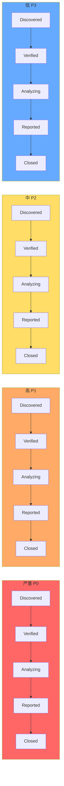

# 状态图设计

## 1. 漏洞生命周期状态图

## 2. 资产状态图

## 3. 环境状态图

## 4. 任务状态图

## 5. 文档状态图

## 6. 工具状态图

## 7. 用户状态图

## 8. 团队成员状态图

## 9. 漏洞优先级与状态关系

## 10. 状态转换规则表

| 当前状态 | 目标状态 | 触发条件 | 权限要求 | 备注 |
|----------|----------|----------|----------|------|
| Discovered | Verified | 审核通过 | 团队负责人 | 需要至少一名审核人 |
| Discovered | Rejected | 审核拒绝 | 团队负责人 | 需要填写拒绝原因 |
| Verified | Analyzing | 开始分析 | 漏洞工程师 | 自动通知分配人 |
| Analyzing | Analyzed | 分析完成 | 漏洞工程师 | 需要提交分析报告 |
| Analyzed | Reported | 报告完成 | 漏洞工程师 | 报告需包含POC |
| Reported | Closed | 归档关闭 | 团队负责人 | 完成归档 |
| Todo | InProgress | 开始处理 | 任务接收人 | 更新团队状态 |
| InProgress | Review | 提交审核 | 任务处理人 | 产出需可验证 |
| Review | Done | 审核通过 | 团队负责人 | 自动通知 |
| Draft | Review | 提交审核 | 文档作者 | 需指定审核人 |
| Review | Published | 审核通过 | 审核人 | 自动索引 |
