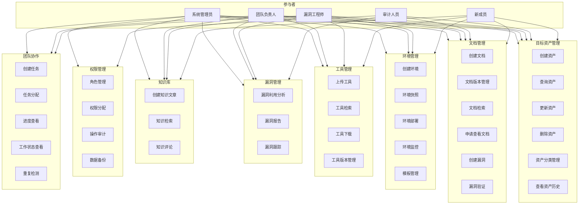
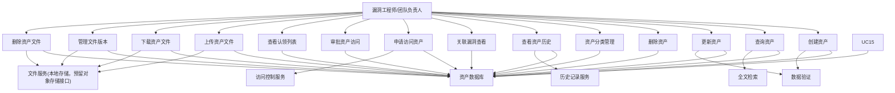
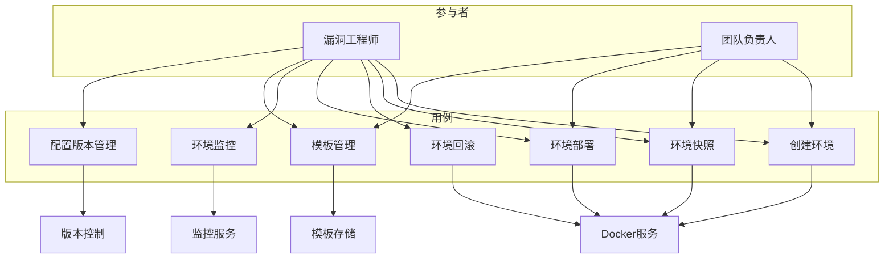
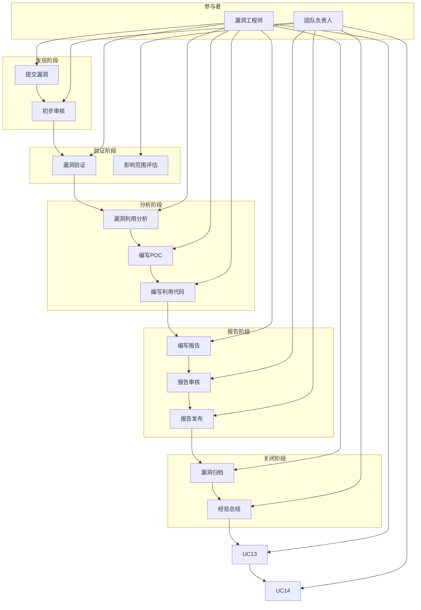
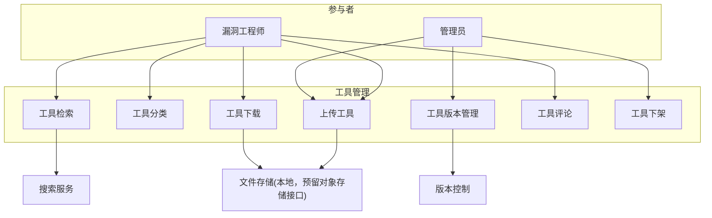
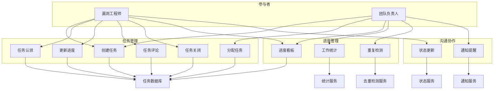
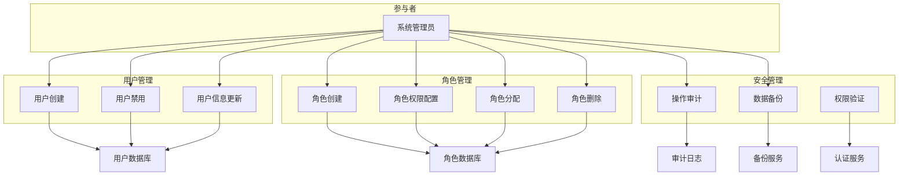
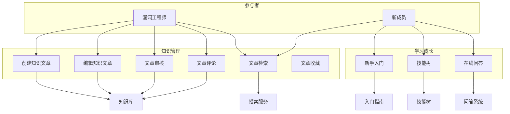

# 系统用例图设计

## 1. 系统总体用例图

## 2. 目标资产管理用例图

## 3. 环境管理用例图

> **说明**：本模块为靶场环境管理功能，相关用例暂保持为空实现，待后续需求明确后再行开发。

## 4. 漏洞生命周期管理用例图

## 5. 工具资源库用例图

## 6. 团队协作用例图

## 7. 权限管理用例图

## 8. 知识库用例图

## 9. 用例说明表

| 用例编号 | 用例名称 | 参与者 | 描述 |
|----------|----------|--------|------|
| UC-ASSET-001 | 创建资产 | 漏洞工程师 | 创建新的目标资产记录 |
| UC-ASSET-002 | 查询资产 | 所有用户 | 根据条件查询资产信息 |
| UC-ASSET-003 | 申请访问资产 | 安全工程师 | 申请访问某资产，部门领导控制可查看的内容范围 |
| UC-ASSET-004 | 审批资产访问 | 团队负责人/部门领导 | 审批安全工程师的资产访问申请，控制可查看的内容 |
| UC-ASSET-005 | 查看认领列表 | 安全工程师/团队负责人 | 查看资产的认领情况或个人认领记录 |
| UC-ASSET-006 | 上传资产文件 | 漏洞工程师 | 上传目标系统的ISO镜像、VMDK、安装包等文件 |
| UC-ASSET-007 | 下载资产文件 | 漏洞工程师 | 下载已授权的资产文件进行漏洞分析 |
| UC-ASSET-008 | 管理文件版本 | 漏洞工程师 | 上传新版本文件并保留历史版本 |
| UC-ASSET-009 | 删除资产文件 | 漏洞工程师 | 删除资产关联的文件 |
| UC-ASSET-010 | 查看应用元数据 | 认领工程师 | 查看资产的应用元数据信息（当前版本） |
| UC-ASSET-011 | 填写应用元数据 | 认领工程师 | 首次填写应用元数据（version=1） |
| UC-ASSET-012 | 更新应用元数据 | 认领工程师 | 更新元数据并保留历史，每次必须填写修改理由 |
| UC-ASSET-013 | 查看历史版本 | 认领工程师 | 查看应用元数据的所有历史版本列表 |
| UC-ASSET-014 | 查看版本详情 | 认领工程师 | 查看指定历史版本的完整信息 |
| UC-ENV-001 | 创建环境 | 漏洞工程师 | 基于模板创建新环境 |
| UC-ENV-002 | 环境快照 | 漏洞工程师 | 保存当前环境配置快照 |
| UC-DOC-001 | 在线创建文档 | 漏洞工程师 | 在线创建新的挖掘文档，选择类型和关联资产 |
| UC-DOC-002 | 在线编辑文档 | 漏洞工程师 | 富文本编辑器在线编辑文档内容 |
| UC-DOC-003 | 在线查看文档 | 漏洞工程师 | 在线查看文档内容，支持渲染富文本 |
| UC-DOC-004 | 删除文档 | 漏洞工程师 | 删除自己创建的文档 |
| UC-DOC-005 | 文档版本管理 | 漏洞工程师 | 管理文档的历史版本，支持回滚 |
| UC-DOC-006 | 发布/取消发布 | 漏洞工程师 | 将文档发布或取消发布 |
| UC-DOC-007 | 搜索文档 | 漏洞工程师 | 全文检索文档内容 |
| UC-VULN-001 | 提交漏洞 | 漏洞工程师 | 提交新发现的漏洞 |
| UC-VULN-002 | 漏洞验证 | 漏洞工程师 | 验证漏洞真实性和影响范围 |
| UC-TOOL-001 | 上传工具 | 漏洞工程师 | 上传新的工具或POC |
| UC-TOOL-002 | 工具检索 | 漏洞工程师 | 根据条件检索工具 |
| UC-TASK-001 | 创建任务 | 团队负责人 | 创建新的工作任务 |
| UC-TASK-002 | 任务分配 | 团队负责人 | 将任务分配给成员 |
| UC-AUTH-001 | 管理权限 | 管理员 | 创建、编辑、删除API权限 |
| UC-AUTH-002 | 管理角色 | 管理员 | 创建、编辑、删除角色，分配权限 |
| UC-AUTH-003 | 分配角色 | 管理员 | 为用户分配角色，支持多角色 |
| UC-AUTH-004 | 直接授权 | 管理员 | 直接分配特定权限给用户（可设置过期时间） |
| UC-AUTH-005 | 查看权限 | 所有用户 | 查看当前用户拥有的权限 |
| UC-AUTH-006 | 管理团队 | 管理员/项目负责人 | 创建、编辑、删除团队，管理团队成员 |
| UC-KNOW-001 | 创建文章 | 漏洞工程师 | 编写知识分享文章 |
| UC-KNOW-002 | 知识检索 | 所有用户 | 检索知识库内容 |
